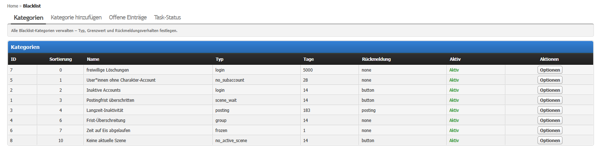
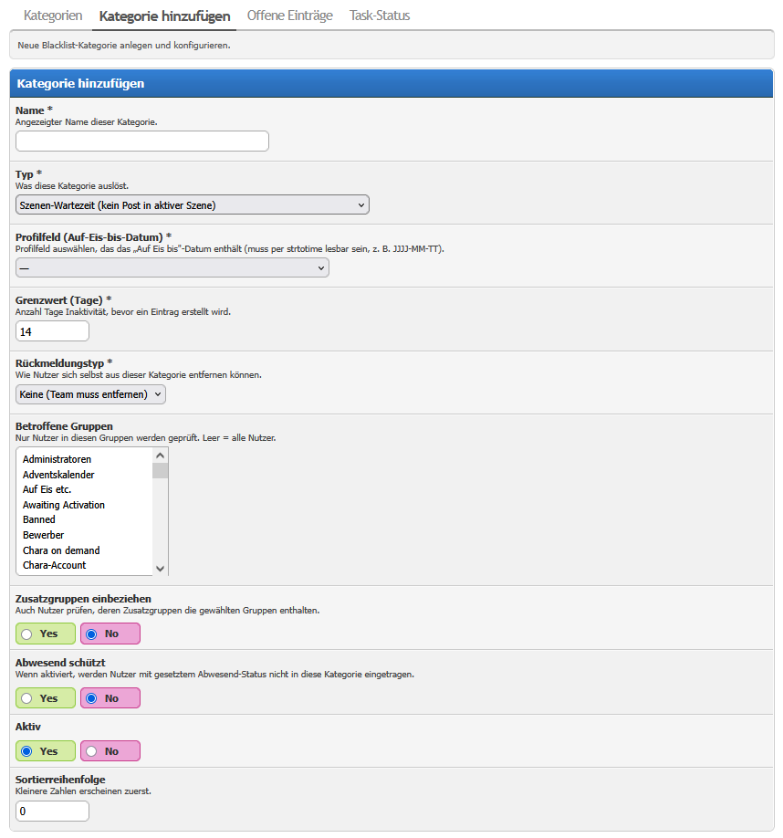
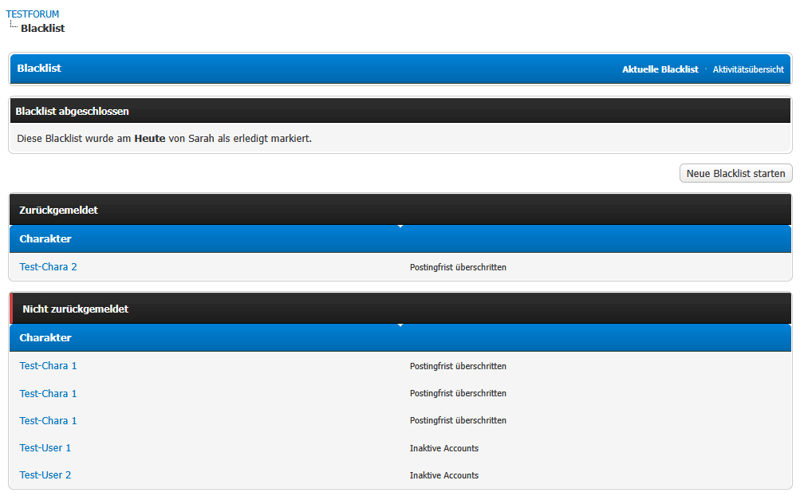
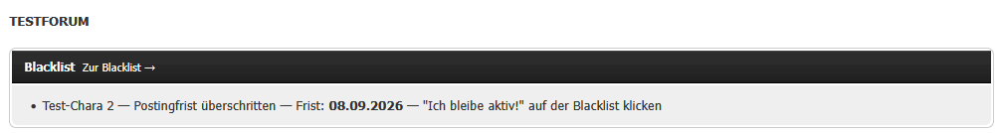
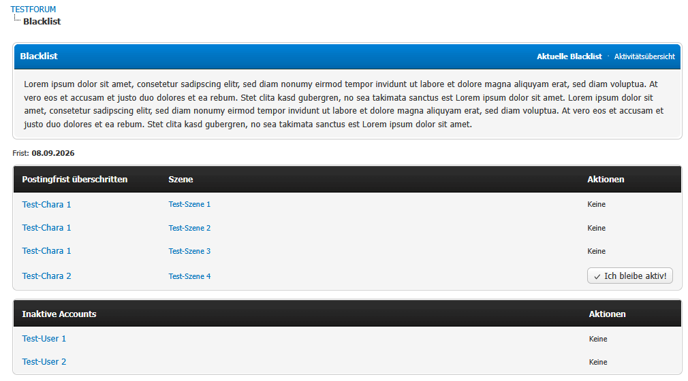
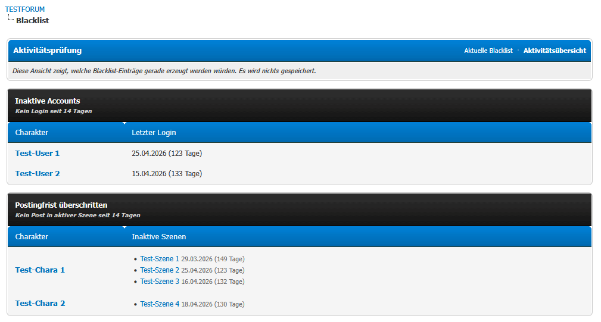
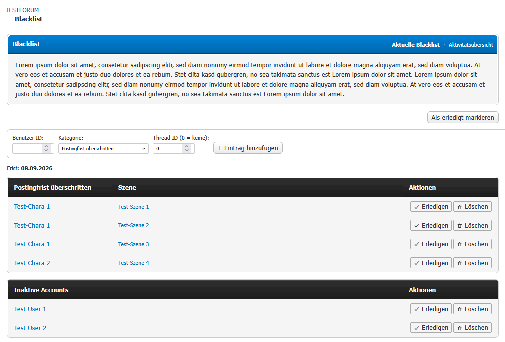

# Blacklist

**Version 1.6.3**

A scene-based activity blacklist plugin for MyBB 1.8 RPG forums with Logbook integration.

The plugin automatically checks whether characters (users) are posting in their active scenes and creates blacklist entries when they become inactive — based on individual scenes, not just global user activity. Blacklists are organized in runs (cycles): the team opens a run, users respond, and the team closes it when done.

---

## Requirements

- MyBB 1.8.x
- PHP 7.4 or 8.x
- **Logbook plugin** (required for scene-based categories — install and activate it first)
- **EnhancedAccountSwitcher plugin** (optional — required for the `No sub-account` category and for aggregating characters in the index notice bar)

---

## Installation

1. Upload all files to your MyBB root directory, keeping the folder structure intact.
2. Go to **ACP → Configuration → Plugins**.
3. Find **Blacklist** and click **Install & Activate**.
4. Go to **ACP → Tools → Blacklist** to create categories.
5. Go to **ACP → Configuration → Settings → Blacklist** to configure deadlines, task schedule and notifications.

### Updating from an older version

1. Upload the new files (overwrite existing ones).
2. **ACP → Configuration → Plugins → Blacklist → Deactivate**, then **Activate** again.

Reactivating reloads all templates and the stylesheet and runs the database migrations. Your settings, categories and entries are kept — only *Uninstall* removes them.

---

## Configuration

| Setting | Description |
|---|---|
| **Deadline (days)** | Number of days after entry creation until the response deadline. Default: 14. |
| **Task: enable automatic generation** | Enable or disable the scheduled blacklist task. |
| **Task: day of month** | Day (1–28) on which the task runs automatically. 0 = daily. Changes take effect immediately after saving. |
| **Task: hour** | Hour (0–23) at which the task runs. Changes take effect immediately after saving. |
| **Task: minute** | Minute (0–59) at which the task runs. Changes take effect immediately after saving. |
| **Notification: Thread ID** | Thread ID to post in when a new blacklist run is started. 0 = disabled. |
| **Notification: Poster UID** | User ID that posts the notification. Required if Thread ID is set. |
| **Moderator groups** | Groups that can manage blacklist entries (besides admins). |
| **Intro text** | Optional HTML/BBCode text shown between the deadline line and the entry list on the public page. |

---

## Usage

### First steps after activation

1. Activate the plugin via **ACP → Plugins**.
2. Go to **ACP → Tools → Blacklist → Categories** and create at least one category.
3. Verify the Logbook plugin is installed and active (required for `scene_wait` categories).
4. Configure the task schedule in **ACP → Configuration → Settings → Blacklist**.
5. Optionally configure the notification thread.

### Managing categories

Go to **ACP → Tools → Blacklist → Categories**.



Click **Add Category** and fill in:

- **Name** – Displayed on the public blacklist page (e.g. "Scene inactivity")
- **Type** – What triggers the category (see below)
- **Threshold (days)** – How many days of inactivity trigger an entry
- **Response type** – How users can remove themselves
- **Affected groups** – Leave empty to check all users; otherwise select specific groups
- **Include additional groups** – Also match users whose additional groups contain the selected groups
- **Away status exempts** – If enabled, users with the away/vacation flag set are skipped



#### Category types

| Type | Description |
|---|---|
| **Scene wait** | No post in an active Logbook scene for X days. Only fixed-order scenes are evaluated: the user whose turn it is gets flagged. Free-order scenes are ignored, because without a defined turn order it is unclear who is supposed to post next. |
| **Registration** | Inactive since registration date |
| **Login** | Inactive since last login |
| **Posting** | No post anywhere for X days |
| **Group membership** | All users in matching groups get an entry |
| **No sub-account** | Registered X+ days ago but has no linked sub-account (requires EnhancedAccountSwitcher) |
| **No current scene** | User has no legitimate active scene right now. A scene only counts when it has at least 2 active participants whose accounts still exist – a scene down to a single remaining participant (or where the other participants' accounts were deleted) does not count. No time threshold; requires Logbook. |
| **Frozen** | A configured date profile field ("frozen until") lies X+ days in the past |

#### Response types

| Type | Description |
|---|---|
| **None** | Entry can only be removed by the team |
| **Button** | User clicks "I'm active!"; entry is resolved immediately |
| **Post in scene** | User must post in the exact scene thread **after** the entry was created. For entries without a scene (e.g. posting inactivity), any post in the forum after the entry was created counts |

### Blacklist runs (cycles)

The blacklist is organized in **runs**. A run represents one complete blacklist cycle:

1. **Start**: The task creates entries automatically, or a team member clicks **Start new blacklist** on the blacklist page. Entries are created immediately on start.
2. **Response phase**: Users see the blacklist at `blacklist.php` and respond by clicking the button, posting in their scene, or contacting the team.
3. **Close**: A team member clicks **Mark as done**. The page then shows two sections:
   - **Responded** – users who resolved their entry
   - **Did not respond – accounts deleted** – users who did not
4. **Repeat**: Click **Start new blacklist** to begin the next cycle.

Only one run can be active at a time. Closing a run does not delete entries — they remain visible in the archive view.



### Index notice bar

Logged-in users see a notice banner on the forum index when they have an open entry in the active run. If EnhancedAccountSwitcher is installed, a main account (`as_uid = 0`) sees one aggregated banner for itself and all linked characters. The banner lists affected characters, deadlines and the required action.

The banner is inserted as `{$blacklist_index_notice}` directly after `{$header}` in the `index` template of every template set on activation, and removed again on deactivation.



### Public blacklist

Users and visitors can see the current blacklist at:

```
https://yourforum.com/blacklist.php
```

Entries are grouped by category. The scene column is only shown for `Scene wait` categories. If a user has a self-removal option (response type *Button* or *Post in scene*), an **I'm active!** button appears next to their own entry. For *Post in scene*, the entry is also resolved automatically as soon as the user posts in that thread.



### Activity simulation

The activity simulation shows, per active category, which accounts would get an entry if the blacklist were generated right now — nothing is saved:

```
https://yourforum.com/blacklist.php?action=activity
```

For `Scene wait` categories, every affected scene is listed with its last post date and the days of inactivity.



### Team management

Users in the configured moderator groups (or admins) see additional controls on the blacklist page:

- **Resolve** – mark an entry as done manually
- **Delete** – permanently remove an entry
- **Add entry** – manually add an entry for any user
- **Mark as done** – close the current run
- **Start new blacklist** – start a new run (only visible when no run is active)



Go to **ACP → Tools → Blacklist → Open Entries** for a full management overview.

### Scene-wait debug trace (team)

If a `Scene wait` entry is unexpectedly missing or present, team members can open

```
https://yourforum.com/blacklist.php?action=activity&debug=1
```

The trace lists every user/scene combination that was evaluated, including turn order, participant count, days waiting and the reason a scene was skipped (solo scene, not their turn, free-order scene).

### Automatic task

The blacklist is generated automatically by MyBB's task system. Configure the schedule in **ACP → Configuration → Settings → Blacklist** (enable, day, hour, minute). Changes take effect immediately after saving — no plugin reactivation needed.

To monitor or trigger the task manually: **ACP → Tools → Blacklist → Task Status**. This page shows:
- Whether the task is enabled and whether the DB matches the settings
- Next and last run timestamps
- The last 10 task log entries (including any errors)
- Buttons to sync the schedule or force a run

### Thread notification

Set a Thread ID and Poster UID in the settings. When a new blacklist run is started and entries are created, the configured user posts exactly **one** message in that thread stating the response deadline and linking to the blacklist. No individual users are listed.

---

## Tips & Tricks

- **Settings are safe on reactivation.** Deactivating/activating (e.g. after an update) never resets your settings, categories or entries.
- **Task schedule changes apply immediately.** The task row is synchronised with the settings on every ACP page load; check **ACP → Tools → Blacklist → Task Status** if in doubt.
- **Deleted accounts stay visible.** If a listed account is deleted, the entry stays with a struck-through name and an "(account deleted)" note.
- **Finished scenes resolve automatically.** When a participant marks their part of a scene as finished in Logbook, their own open entries for that scene are resolved. Once only one active participant is left, all open entries for that scene are resolved.

---

## Uninstallation

1. Go to **ACP → Configuration → Plugins** → **Deactivate** Blacklist.
2. Click **Uninstall**.

Deactivating removes the templates, the stylesheet from all themes and the index notice placeholder, and disables the task. Uninstalling additionally removes all database tables (`blacklist_categories`, `blacklist_entries`, `blacklist_runs`), all settings and the scheduled task. The Logbook plugin is not affected.

---

## Changelog

See [CHANGELOG.md](CHANGELOG.md).
